<p align="center">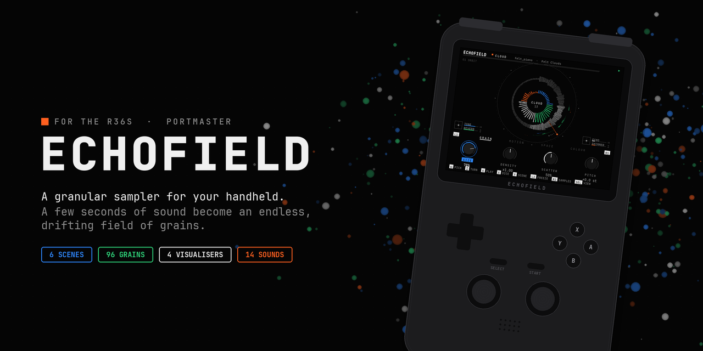</p>

<p align="center">
  <b>A granular sampler for the R36S handheld (ArkOS, PortMaster)</b><br>
  A few seconds of sound become an endless, drifting field of grains: pads, glitter, tape loops and slow swells.
</p>

<p align="center">
  <a href="https://github.com/Philip-Bos/echofield-r36s/releases/latest"><b>Download</b></a> ·
  <a href="#install">Install</a> ·
  <a href="#controls">Controls</a> ·
  <a href="#screens">Screens</a> ·
  <a href="#building">Build it yourself</a>
</p>

<p align="center">
  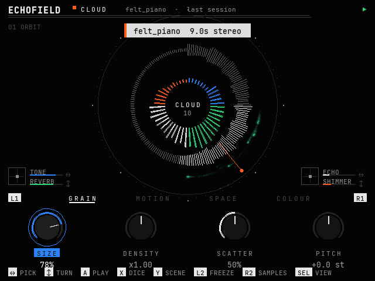
  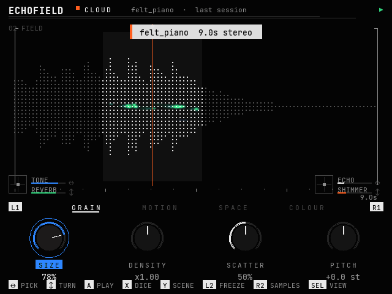
</p>

> [!WARNING]
> **Not yet tested on a real R36S.** The aarch64 binary is built and statically checked, and the engine, file formats and
> UI pass automated tests on desktop, but nobody has run it on the handheld yet. If you try it, please report what
> happens ([what to check](docs/HARDWARE_TESTS.md)).

> [!NOTE]
> **Recording from a USB audio input is not working yet** in this version. Play the factory sounds or copy your own WAV
> files to the SD card.

---

## What it is

ECHOFIELD reads tiny slices of a sample (grains), dozens at a time, each with its own pitch, place and fade, and
overlaps them into one sound that keeps moving. Press **A** and it plays; move the sticks and it changes.

<p align="center">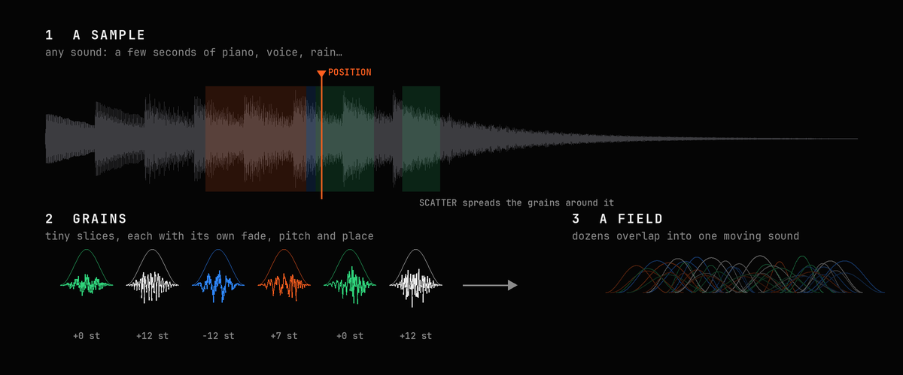</p>

- **Six scenes:** CLOUD, DUST, TAPE, BLOOM, PULSE and DRIFT, each a different way for grains to be born and move.
- **The sticks are the effects:** tone, reverb, echo and shimmer, always under your thumbs.
- **Dice with undo:** **X** rolls a new sound that still sounds good, **B** takes it back.
- **Four visualisers:** ORBIT, FIELD, SPECTRUM and SCOPE, switched with **SELECT**.
- **14 ready-made sounds** on 14 factory samples, plus your own WAV files.
- **DRIFT ORACLE:** optional generative harmony that wanders through a key and scale you choose.
- **Non-destructive sample editor** that renders a trimmed region into a new file.
- **Everything is saved:** your session comes back exactly as you left it.

## Install

1. Make sure PortMaster is installed (ArkOS: *Options → Tools → PortMaster*).
2. Download **`ECHOFIELD_R36S_PortMaster.zip`** from the [latest release](https://github.com/Philip-Bos/echofield-r36s/releases/latest).
3. Extract it into the `ports` folder of the SD card:
   - single card: `/roms/ports/` (on a computer: the `EASYROMS` partition → `ports/`)
   - two cards: `/roms2/ports/`

   You should end up with `ports/Echofield.sh` and `ports/echofield/echofield.aarch64`.
4. Restart EmulationStation (*START → Quit → Restart EmulationStation*) or reboot.
5. Open **PORTS → ECHOFIELD** and press **A**.

**Updating:** extract a newer zip over the old one. Your samples, sounds and projects live in
`ports/echofield/userdata/`, which the zip never contains, so they are never overwritten.

## Controls

<p align="center">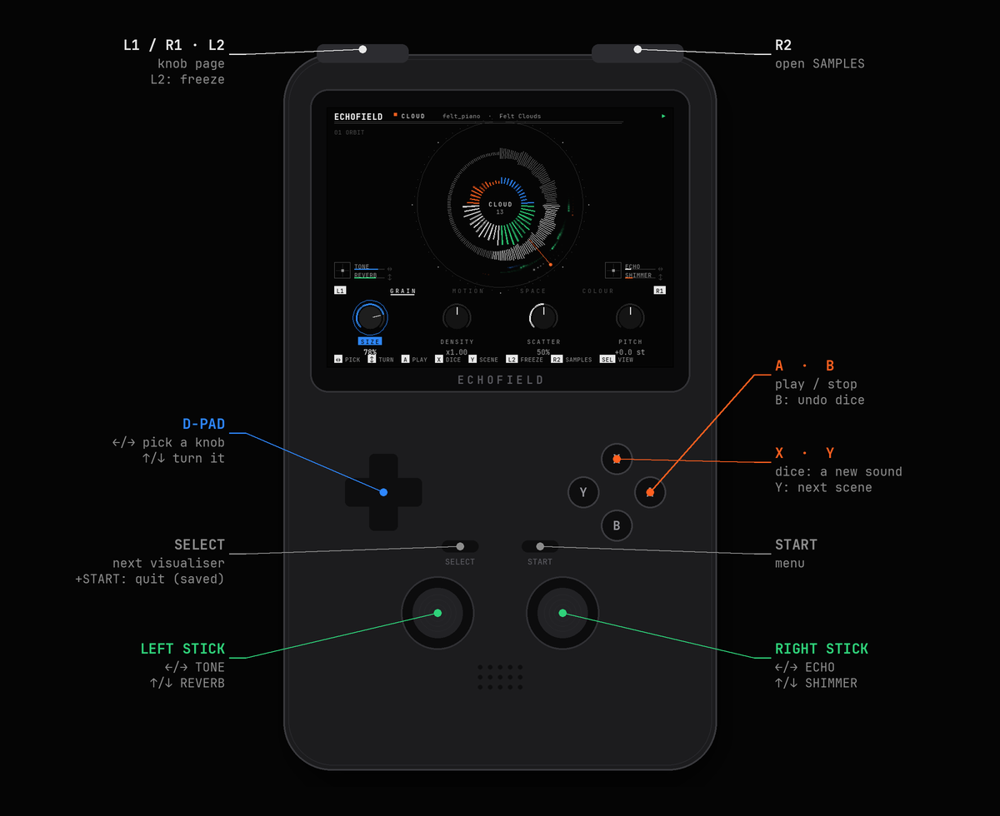</p>

| Button | On the main screen |
| --- | --- |
| **D-pad ← →** | pick a knob |
| **D-pad ↑ ↓** | turn it (hold to go faster) |
| **L1 / R1** | knob page: GRAIN, MOTION, SPACE, COLOUR |
| **A** | play / stop |
| **X** | dice: a new random sound |
| **B** | undo the dice |
| **Y** | next scene |
| **L2** | freeze |
| **R2** | open SAMPLES (R2 again comes back) |
| **SELECT** | next visualiser |
| **START** | menu |
| **SELECT + START** | quit (your session is saved) |
| **Left stick** | ← → TONE (dark to bright), ↑ ↓ REVERB |
| **Right stick** | ← → ECHO, ↑ ↓ SHIMMER |

Push a stick to move the effect; let go and it stays there. In lists, ↑ ↓ select, **A** confirms and **B** goes back.
If A and B feel swapped on your unit: *SETTINGS → SWAP A / B*.

## The scenes

| Scene | What it does |
| --- | --- |
| **CLOUD** | long overlapping grains melt into a pad |
| **DUST** | tiny glinting specks scattered in space |
| **TAPE** | three slow tape loops at half, normal and double speed |
| **BLOOM** | slow swells with octave and fifth overtones |
| **PULSE** | soft notes on a slow euclidean clock |
| **DRIFT** | everything wanders slowly and keeps evolving |

## Screens

<table>
  <tr>
    <td>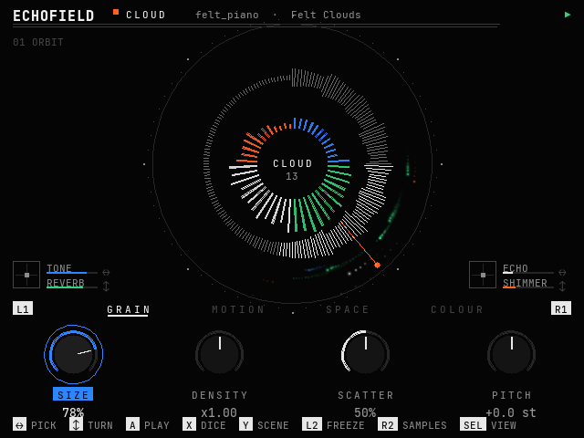<br><sub><b>ORBIT</b>: the sample as a ring; grains orbit it, coloured by pitch</sub></td>
    <td>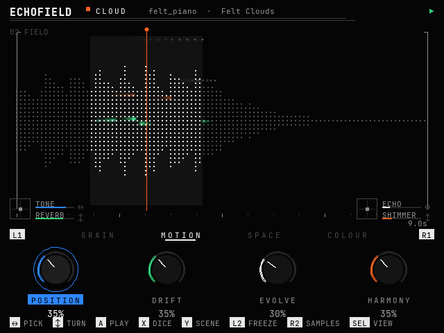<br><sub><b>FIELD</b>: the sample as a dot matrix with the grains on top</sub></td>
  </tr>
  <tr>
    <td>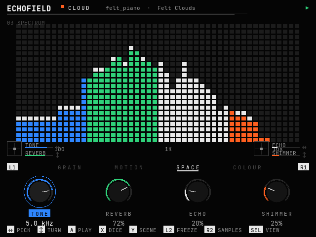<br><sub><b>SPECTRUM</b>: dot-matrix analyser of the output</sub></td>
    <td>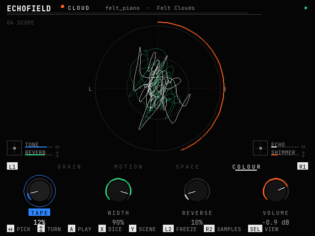<br><sub><b>SCOPE</b>: stereo XY scope, a wide figure is a wide sound</sub></td>
  </tr>
  <tr>
    <td>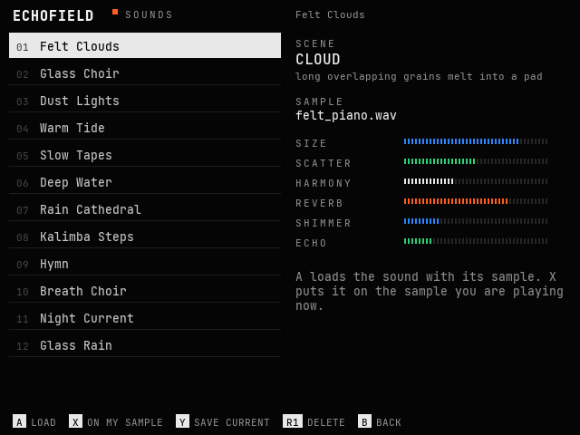<br><sub><b>SOUNDS</b>: ready-made patches; save your own</sub></td>
    <td>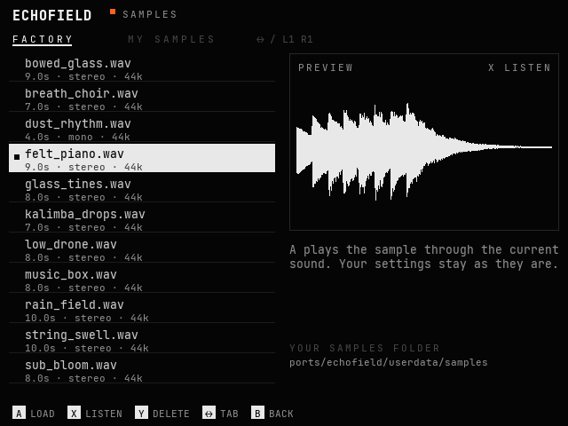<br><sub><b>SAMPLES</b>: factory sounds and your own WAV files, with preview</sub></td>
  </tr>
  <tr>
    <td>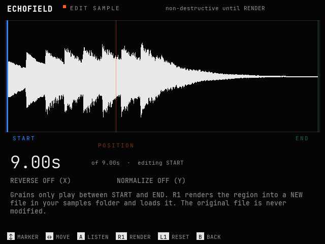<br><sub><b>EDIT SAMPLE</b>: trim, reverse, normalize, render a new file</sub></td>
    <td>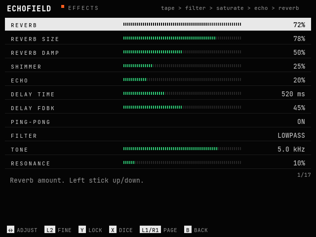<br><sub><b>EFFECTS</b>: tape, filter, saturation, echo, reverb, shimmer</sub></td>
  </tr>
  <tr>
    <td>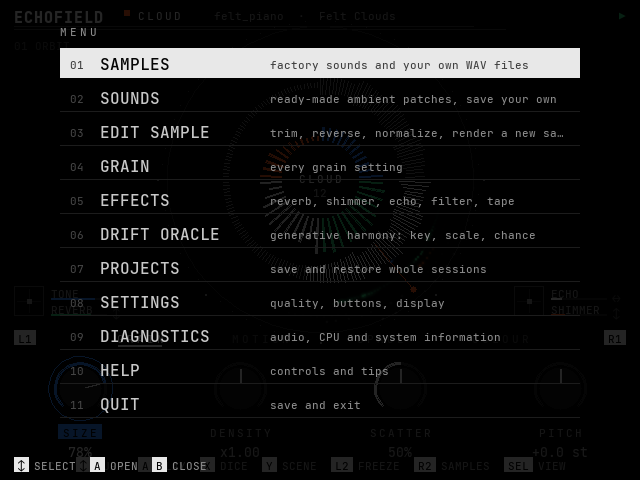<br><sub><b>MENU</b> (START)</sub></td>
    <td>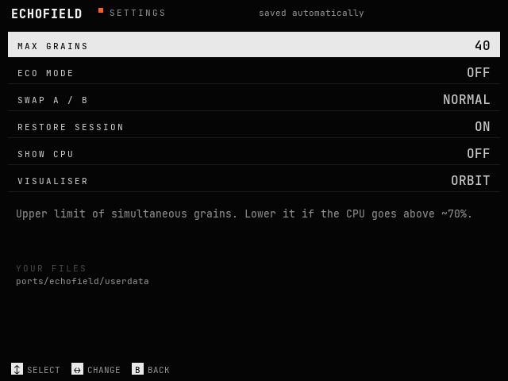<br><sub><b>SETTINGS</b>: grain limit, eco mode, buttons, display</sub></td>
  </tr>
</table>

## Your own samples

Copy WAV files to `ports/echofield/userdata/samples/` (the exact folder is shown on the SAMPLES screen). Mono or stereo,
any sample rate, PCM 8/16/24/32-bit or 32/64-bit float. Sustained sounds work best: pads, voices, strings, field
recordings.

In **EDIT SAMPLE** you set START and END, reverse and normalize without touching the file; **R1** renders the region into
a *new* file in your samples folder. Originals are never changed.

```
ports/echofield/userdata/
  samples/   presets/   projects/
  session.efproj   settings.ini   echofield.log   diagnostics.txt
```

If the ports partition is read-only, ECHOFIELD uses `~/.local/share/echofield/` instead.

## Under the hood

- **Grains:** up to 96 voices (40 by default; *SETTINGS → MAX GRAINS*), 4-point Hermite interpolation, five grain
  envelopes, per-grain pitch, position, size, direction and colour, sample-accurate scheduling, click-free sample
  swaps.
- **Effects, in signal order:** tape (wow, flutter, wear, hiss) → state-variable filter → saturation → stereo
  ping-pong echo → 8-line FDN reverb with octave-up shimmer → width → level → soft limiter. Feedback paths are
  hard-limited, so nothing runs away.
- **DRIFT ORACLE:** root and scale (major, minor, modes, pentatonics, hirajoshi, in-sen, whole tone, "glass"), weighted
  bass motion, suspended chords, glide, and chance events such as blooms, reverse swells and octave flickers.
- **Native C + SDL2**, 640×480, needing only libc, libm and SDL2 on any aarch64 glibc ≥ 2.17 (ArkOS has 2.30).

## Troubleshooting

- **Nothing in PORTS:** check the file locations above and restart EmulationStation.
- **Black screen or it quits at once:** read `ports/echofield/log.txt`.
- **No sound:** *DIAGNOSTICS* shows the audio output; check the system volume (ArkOS volume keys).
- **Crackles:** lower *SETTINGS → MAX GRAINS* to 24–32, or turn on *ECO MODE*.
- **Over SSH:** `cd /roms/ports/echofield && ./echofield.aarch64 --diag` prints a system report, and `--bench 5`
  measures DSP speed per scene.

## Building

You need `clang`, `lld` and `python3`. No aarch64 sysroot or SDL headers are needed.

```bash
./build.sh test      # automated tests on the host (with ASan/UBSan)
./build.sh host      # desktop build for development (Linux, system SDL2)
./build.sh r36s      # build/echofield.aarch64, with ELF and ABI checks
./package.sh         # dist/ECHOFIELD_R36S_PortMaster.zip
```

The R36S binary uses a small, layout-safe subset of libc (`src/compat/minilibc.h`) and SDL2 (`src/compat/sdl_min.h`). It
is compiled with `clang --target=aarch64-linux-gnu -mcpu=cortex-a35`, started by a tiny `_start`
(`src/crt/start_aarch64.S`), and linked with `ld.lld` against generated stub libraries that carry the real SONAMEs and
the `GLIBC_2.17` symbol version (`tools/mkstubs.py`). `tools/check_elf.py` verifies the result.

Headless screenshots of every screen:
`SDL_VIDEODRIVER=dummy ECHOFIELD_APPDIR=port/echofield build/echofield.host --windowed --screenshots DIR`.

| Source | Role |
| --- | --- |
| `src/engine.c` | granular engine, scenes, DRIFT ORACLE, effects, limiter (real-time, lock-free, no allocation) |
| `src/vis.c` | the four visualisers |
| `src/ui.c`, `src/draw.c` | 640×480 interface, controls, background jobs |
| `src/sample.c` | WAV decode/encode, sinc resampler, render, trim, reverse |
| `src/store.c` | sounds, projects, settings, the constrained dice |
| `src/audio.c` | SDL2 audio output |
| `src/diag.c` | diagnostics, `--diag`, `--bench` |

## License

MIT, see [LICENSE](LICENSE). The factory samples are original material synthesized by `tools/gen_samples.py`, released
as CC0. Fonts: JetBrains Mono (OFL) and DejaVu (see `port/echofield/licenses/`).
